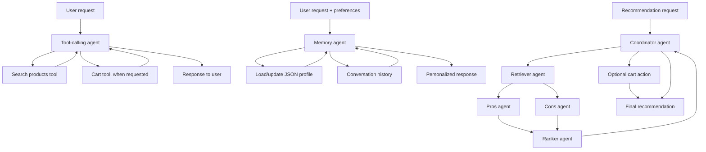

# AI Shopping Assistant: Tool Calling, Memory & Multi-Agent System

## Overview

This project explores three patterns for building LLM-powered shopping workflows over a predefined e-commerce catalog:

1. **Tool-calling agent** — searches and filters products, sorts results, and can add a selected item to a cart.
2. **Memory agent** — extracts user preferences, persists a profile in JSON, and reuses short-term conversation history across turns.
3. **Multi-agent recommendation system** — coordinates specialized agents to retrieve candidates, analyze pros and cons, rank products, and optionally add the selected product to the cart.

The implementation is in [`notebooks/ai_shopping_agents.ipynb`](notebooks/ai_shopping_agents.ipynb).

## Architecture

An editable Mermaid source is also available at [`docs/architecture.mmd`](docs/architecture.mmd).

## Key implementation details

### 1. Tool calling
- Defines structured tool schemas from function docstrings.
- Runs a bounded ReAct-style loop for model responses and tool calls.
- Records tool activity for inspection and debugging.

### 2. Memory
- Loads and saves a user profile as JSON.
- Extracts preferences such as name, preferred brand, and budget.
- Reuses conversation history to support follow-up requests.

### 3. Multi-agent orchestration
- Retrieves candidate products from the catalog.
- Generates product pros and cons.
- Ranks candidates by rating, using price as a tie-breaker.
- Respects the user's maximum price; if no candidate is within budget, it returns no suitable product rather than silently selecting an over-budget option.
- Adds the selected item to the cart only when the user requests it.

## Tech stack

- Python
- Jupyter Notebook
- LangChain message/tool abstractions
- LLM tool calling
- JSON for profile persistence

## How to run

1. Install the dependencies required by the notebook/template (the original template references `langchain-openai` and `langchain-core`).
2. Configure the model provider credentials/environment expected by the template.
3. Open `notebooks/ai_shopping_agents.ipynb` in Jupyter or Google Colab.
4. Run the template cell first, then the implementation cell, then the examples for Tasks 1–3.

The notebook structure and cell order from the assignment have been preserved.

## Scope and limitations

- Uses a predefined demo product catalog; it is not connected to a live retailer, inventory system, or payment provider.
- LLM-backed examples require valid model credentials and may depend on the selected model/provider.
- The project is a prototype demonstrating agent patterns, not a production-ready commerce system.
- The ranking logic is deterministic once candidate products and their attributes are available; the quality of candidate retrieval and generated pros/cons depends on the underlying implementation/model.

## Validation status

**9 out of 10 checks passed** during the testing of the code version submitted for evaluation during "Agents-Week." A failure occurred when selecting an item that exceeded the budget, specifically in a situation where none of the candidates met the maximum price constraint. This mechanism has been corrected in the current version of the code.
