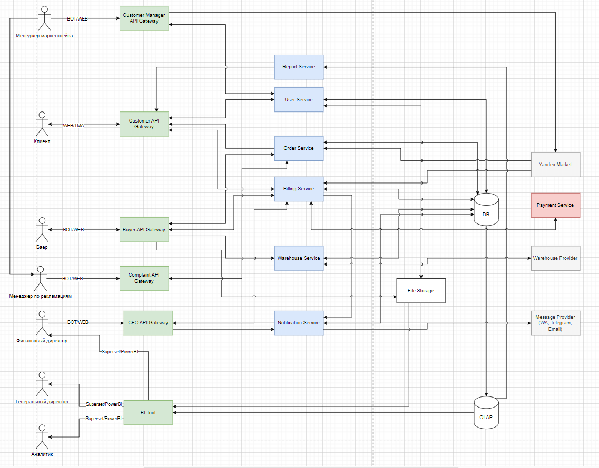

# E-commerce Marketplace Platform — System Architecture

**Business / System Analyst · System Design · APIs · Microservices**

> Portfolio case based on a marketplace project. The case focuses on system structure, responsibilities and integrations; sensitive implementation details are omitted.

## Overview

Worked with the architecture of an e-commerce marketplace platform connecting marketplace operations, customers, buying, complaints, financial control, orders, warehouse processes, notifications and analytics.

## Business Context

The platform needed to support multiple operational roles while integrating internal services with external marketplace, payment, warehouse and messaging providers.

## Architecture

## Main Components

### API Gateways
Separate gateways provide entry points for different user groups and interaction channels.

### Core Services
- **User Service** — user and access-related operations
- **Order Service** — order lifecycle and processing
- **Billing Service** — financial and payment-related operations
- **Warehouse Service** — warehouse / fulfillment interactions
- **Report Service** — reporting functionality
- **Notification Service** — user notifications

### Data Layer

Operational and analytical workloads are separated:

`Transactional DB → OLAP → BI`

### External Integrations

- Marketplace provider
- Payment provider
- Warehouse provider
- Messaging provider
- File storage

## Analyst Contribution

- analyzed business processes and system boundaries;
- mapped user roles to system entry points;
- identified service responsibilities and integration points;
- worked with API/data flows and dependencies;
- translated business needs into technical requirements;
- supported reporting and BI requirements.

## Key Skills Demonstrated

**Business Analysis · System Analysis · Architecture Documentation · API Integration · Microservices · Data Flows · Requirements Engineering · E-commerce Systems**
