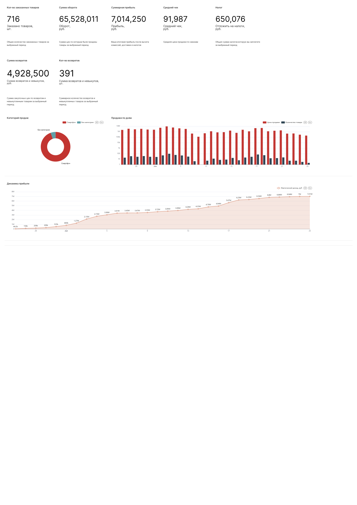
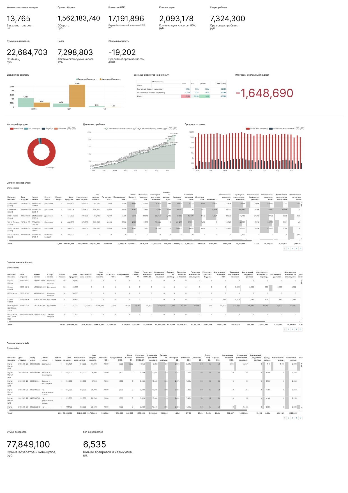

# Marketplace Profitability & Operations Analytics

**Business / Data Analyst · SQL · Apache Superset · Financial Analytics**

> Dashboard case based on test / illustrative data. The screenshots are used to demonstrate the analytical approach and BI design.

## Overview

Designed BI dashboards for monitoring marketplace sales, profitability and operational performance by combining order, product, commission, logistics and return data.

## Business Problem

Management needed a consolidated view of:

- sales and turnover;
- profit and average order value;
- marketplace commissions and logistics costs;
- returns;
- category structure;
- daily sales and profit dynamics;
- budget performance;
- order-level details for investigation.

## Data Flow

```text
Orders / Order Items
        +
Products / Prices
        +
Commissions / Logistics
        +
Returns / Financial Data
        ↓
SQL Transformation
        ↓
Analytical Dataset
        ↓
Apache Superset
```

## Dashboard 1 — Executive Overview

The dashboard combines executive KPIs with sales and profit dynamics:

- sold items;
- turnover;
- profit;
- average order value;
- taxes;
- returns;
- category structure;
- daily sales;
- profit dynamics.

The supplied test dashboard illustrates metrics such as **716 sold items, 65.5M turnover, 7.0M profit, 91,987 average check and 4.9M returns**.



## Dashboard 2 — Marketplace & Financial Analytics

This view adds:

- sales and turnover;
- marketplace commissions;
- profit and tax;
- budget analysis;
- operational breakdowns;
- detailed order-level tables.

The test dashboard includes an illustrative budget variance of **-1.65M**.



## Dashboard 3 — Returns Analysis

A detailed return view provides a list of returned items with quantities, prices and status information for operational investigation.


## Key Insights

The dashboards are designed to help management:

- monitor sales and profitability in one place;
- understand the cost structure behind marketplace revenue;
- identify return dynamics and their financial impact;
- compare actual performance with budget;
- move from executive KPIs to detailed records for investigation.

## My Contribution

- analyzed reporting requirements and business questions;
- defined analytical metrics and dimensions;
- designed SQL logic for the reporting dataset;
- combined order, product, commission and logistics data;
- built interactive Apache Superset dashboards;
- designed drill-down views from KPIs to detailed records;
- structured reporting around management decision-making.

## Technologies

**SQL:** PostgreSQL · CTE · Window Functions · JOIN · CASE · Aggregations  
**BI:** Apache Superset  
**Domain:** E-commerce · Marketplace Analytics · Profitability · Returns · Financial Operations

## Portfolio Note

All figures shown in the screenshots are test / illustrative data for portfolio purposes.
